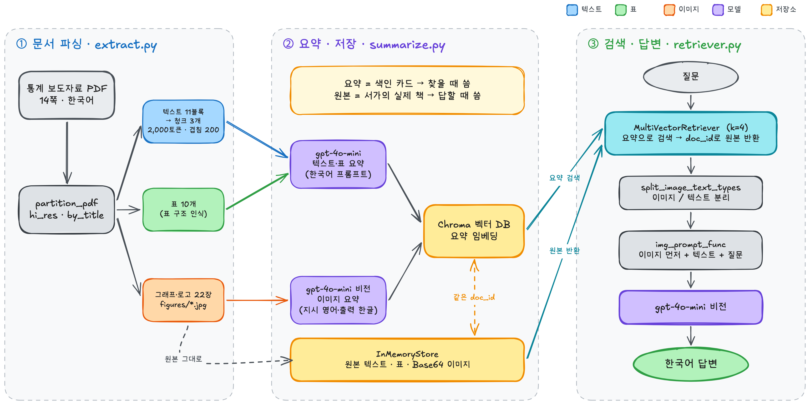
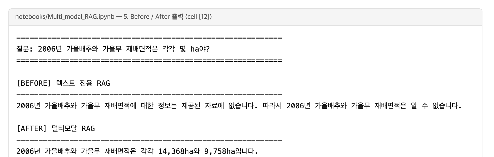
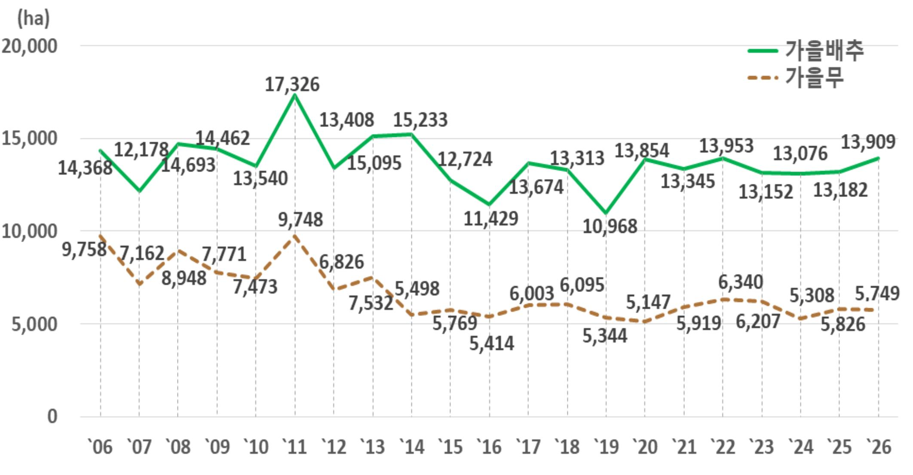

# Multimodal RAG 

통계 보도자료 속 **텍스트·표·그래프**를 모두 검색 대상으로 삼아, 본문에 없고 그래프·통계표에만 있는 수치까지 근거로 답하는 멀티모달 RAG입니다.

- **자료**: 국가데이터처 보도자료 「2026년 재배면적조사 결과 - 가을배추, 가을무 -」 (2026-10-30 공표, 14쪽, 한국어)
- **출처**: [KDI 경제교육·정보센터 경제정책자료](https://eiec.kdi.re.kr/policy/materialView.do?num=288835)의 첨부 PDF (공개 자료).

## 1. 문제 정의

통계 보도자료는 본문에 **올해와 작년 값만** 쓰고, 긴 시계열과 시도별 상세는 **그래프와 통계표**로만 보여줍니다. 이 자료도 본문은 "2026년 가을배추 재배면적 13,909ha, 전년 대비 5.5% 증가" 정도이고, 2006~2026년 21년 추이와 시도별 면적은 꺾은선·막대그래프와 통계표에만 있습니다.

텍스트만 쓰는 RAG에는 두 가지 문제가 생깁니다.

1. **그래프·통계표에만 있는 숫자는 볼 수 없음**: "2006년 가을배추 재배면적"(14,368ha)은 본문 문장에 없고, 5쪽 추이 그래프와 10쪽 통계표에만 있습니다.
2. **그래프 라벨이 텍스트로 섞여도 연결이 끊김**: 그래프 숫자 일부가 텍스트로 추출되지만 `13,854 3,9 13,674 43 313 13,345`처럼 연도 없이 뒤섞여, 어느 해의 값인지 알 수 없습니다.

그래서 "2006년 재배면적은?" 같은 과거 추이 질문에 텍스트 RAG는 "자료에 없다"고 답합니다(아래 Before/After). 이 프로젝트는 그래프와 표를 요약해 검색 대상에 넣고, 답변할 때는 **원본 그래프 이미지와 통계표**를 모델에 직접 넘겨 이 문제를 해결합니다.

## 2. 아키텍처



### 왜 요약으로 검색하고, 원본으로 답하는가

처음에는 "그래프를 그냥 모델한테 보여주면 되지 않나?"라고 생각했는데, 막상 만들어 보니 찾는 단계와 읽는 단계에서 필요한 게 달랐습니다.

- **찾을 때는 요약이 필요했습니다.** 질문은 글자이고 그래프는 그림이라, 둘을 바로 비교할 방법이 없습니다. 그래서 그래프마다 "2006~2026년 가을배추·가을무 재배면적 추이 그래프"처럼 무슨 그래프인지 글로 적어 두고, 질문이 들어오면 이 설명과 비교해서 찾게 했습니다. 표도 마찬가지로, 숫자만 줄줄이 늘어선 원문보다 "시도별 가을배추 재배면적 표"라는 설명이 질문과 훨씬 잘 맞았습니다.
- **답할 때는 원본이 필요했습니다.** 요약은 "어떤 그래프인지"를 알려주는 이름표일 뿐이라, 21년치 숫자를 다 담지 못합니다. 실제로 이번 결과에서도 요약 중 하나가 시도별 재배면적 표를 "인구 변화"라고 잘못 적었습니다. 요약만 보고 답했다면 틀린 답이 나왔을 겁니다. 그래서 요약과 원본에 같은 번호(`doc_id`)를 붙여 두고, 요약으로 찾은 다음 그 번호로 원본 그래프와 표를 꺼내 모델이 직접 보게 했습니다. 2006년 14,368ha 같은 숫자는 요약이 아니라 그래프에 적힌 라벨에서 읽어 온 값입니다.

정리하면, 요약은 도서관의 **색인 카드**이고 원본은 **서가에 있는 실제 책**입니다. 카드로 책을 찾고, 답은 책을 펴서 읽는 구조입니다.

## 3. 기술 선택 근거

### 모델 — `gpt-4o-mini`

- 하나의 모델로 텍스트 요약, 이미지 요약(비전), 그래프를 보고 답변하기까지 모두 처리합니다.
- 교재의 `gpt-4-vision-preview`는 지원이 끝났고, 4o-mini가 비전 기능을 포함하면서 비용이 훨씬 낮습니다.
- 번역 체인(선택)은 로컬 모델 Ollama `llama3.1:8b`로 구성했습니다(`src/retriever.py`의 `final_chain`). 로컬에 모델(4.9GB)이 없어 노트북에서는 건너뜁니다.

### 파싱·청크 — `hi_res` + `by_title` → 2,000토큰 / 겹침 200

- `strategy="hi_res"`, `infer_table_structure=True`: 레이아웃 모델을 써야 표와 그래프 영역이 따로 잡힙니다. 그 결과 표 10개와 그래프·로고 22장이 분리됐습니다.
- `by_title`: 보도자료는 "1. 가을배추 재배면적"처럼 제목이 곧 주제 경계라 제목 기준으로 묶었습니다.
- 2,000토큰 / 겹침 200: 11블록을 다시 나눠 3개 청크가 됐고, 겹침 200은 청크 경계에서 문장이 잘려 뜻이 사라지는 것을 막습니다.

### 프롬프트 언어

- **텍스트·표 요약 — 한국어**: 자료와 질문이 모두 한국어라 요약도 한국어여야 질문과 임베딩이 가깝습니다.
- **이미지 요약 — 지시는 영어, 출력은 한국어**: 모델이 가장 안정적으로 따르는 영어로 지시하고, 마지막 줄로 한국어(Hangul) 출력을 요구해 검색 언어를 맞췄습니다.
- **답변 — 교안 프롬프트 + 한 줄**: "질문에 나온 기준 시점은 답변에 포함"을 추가했습니다. 통계 질문은 "2026년", "전년 대비" 같은 기준이 빠지면 숫자의 의미가 사라집니다.

### 자료 선택

- **한글(HWP)로 만든 통계 보도자료 중, 텍스트 레이어가 그대로 쓰이는 PDF**를 골랐습니다. 교안의 `extract_pdf_elements`(hi_res)는 `unstructured`가 PDF를 "너무 복잡하다"(`is_pdf_too_complex`)고 판정하면 텍스트 레이어를 버리고 전부 영어로 OCR해 한글이 깨집니다. 국문 IR 자료, 소비자물가동향, 인구동향 등 후보 10여 개를 이 판정으로 걸러, 통과한 10~30쪽 자료 중 그래프·표가 있는 이 자료를 선택했습니다.
- **데이터 라벨이 있는 그래프**: Tesla IR 자료(라벨 없음)로 시험했을 때는 막대 높이를 어림해야 해 오답이 많았습니다. 이 자료는 그래프의 모든 점에 숫자가 적혀 있습니다.

### 요약 저장 — `data/processed/summaries.pkl`

- 요약은 실행할 때마다 조금씩 달라져 검색 결과까지 바뀝니다(한계 1). 결과를 재현할 수 있도록, 추출 결과가 똑같을 때만 저장된 요약을 불러옵니다.

## 4. 실행 방법

사전 설치 (파이썬 패키지가 아닌 OS 프로그램):

```bash
brew install poppler tesseract    # 윈도우: 설치 후 Path 등록
pdftoppm -h && tesseract -v       # 둘 다 출력되면 성공
```

```bash
git clone https://github.com/Navi-Up/multimodal-rag.git
cd multimodal-rag

# 가상환경 생성 및 활성화 (Python 3.11 / 3.12)
python -m venv .venv
source .venv/bin/activate          # 윈도우: .venv\Scripts\activate

# 의존성 설치
pip install --upgrade pip
pip install -r requirements.txt     # 또는 requirements.lock.txt

# 커널 등록
python -m ipykernel install --user --name multimodal-rag

# .env 작성
cp .env.example .env                # 윈도우: copy .env.example .env
# .env 파일을 열어 실제 API 키를 입력
```

위 출처 링크의 PDF를 `data/crop_area_2026_autumn.pdf`로 저장한 뒤 [notebooks/Multi_modal_RAG.ipynb](notebooks/Multi_modal_RAG.ipynb)를 위에서부터 실행합니다. 추출 이미지는 실행 위치인 `notebooks/figures/`에 저장됩니다. 처음 실행하면 요약을 새로 만들어 `data/processed/summaries.pkl`에 저장합니다.

```
multimodal-rag/
├── .env.example                # 필요한 환경변수 안내 (실제 키는 .env, Git 제외)
├── requirements.txt            # 의존성 목록
├── requirements.lock.txt       # 동작 확인한 버전 고정
├── data/                       # 원본 PDF·요약 저장본 (Git 제외)
├── docs/images/                # README용 캡처
├── notebooks/
│   └── Multi_modal_RAG.ipynb   # 실행 노트북 (출력 셀 포함)
├── practice/                   # 수업 단계별 연습 노트북
└── src/
    ├── extract.py              # ① PDF 파싱·분류
    ├── summarize.py            # 텍스트·표·이미지 요약
    └── retriever.py            # ② 다중 벡터 검색기 · ③ 최종 체인 · 번역 체인
```

## 5. 결과

### Before / After

같은 질문을 **텍스트 전용 RAG**(이미지·표를 뺀 것 외에는 임베딩·모델·프롬프트·k=4 동일)와 **멀티모달 RAG**에 던졌습니다.



| 근거 원본 (추출된 5쪽 그래프) | 정답 |
| --- | --- |
|  | 2006년 가을배추 14,368ha, 가을무 9,758ha |

- **텍스트 전용 RAG**: "2006년 재배면적에 대한 정보는 자료에 없다"고 답했습니다. 본문은 2024~2026년 값만 다루고, 2006년 값은 그래프와 통계표에만 있기 때문입니다.
- **멀티모달 RAG**: "2006~2026년 가을배추·가을무 재배면적 그래프" 요약으로 해당 그래프를 찾고, 원본 이미지의 데이터 라벨에서 **14,368ha와 9,758ha를 정확히** 읽었습니다.

### 질의응답 5건

정답은 원본 PDF를 직접 확인한 값입니다.

| # | 질문 | 답변 (멀티모달 RAG) | 근거 원본 종류 | 정답 (출처) |
| --- | --- | --- | --- | --- |
| 1 | 2006년 가을배추와 가을무 재배면적은 각각 몇 ha야? | 2006년 가을배추 재배면적은 14,368ha, 가을무 재배면적은 9,758ha입니다. | 이미지, 텍스트 | ✅ 14,368ha / 9,758ha (5쪽 그래프, 10쪽 통계표) |
| 2 | 2026년 가을배추 재배면적은 몇 ha이고 전년 대비 증감률은 몇 %야? | 2026년 가을배추 재배면적은 13,909ha이고, 전년 대비 5.5% 증가했습니다. | 이미지, 텍스트 | ✅ 13,909ha, +5.5% (5쪽 표) |
| 3 | 2026년 가을무 재배면적은 몇 ha이고 전년 대비 증감률은 몇 %야? | 2026년 가을무 재배면적은 5,749ha이고, 전년 대비 1.3% 감소했습니다. | 이미지, 텍스트 | ✅ 5,749ha, -1.3% (5쪽 표) |
| 4 | 2026년 가을배추 재배면적 상위 3개 시도와 각각의 면적은? | 1. 전남광주: 3,686ha 2. 충북: 2,130ha 3. 강원: 1,779ha | 이미지, 텍스트 | ✅ 전남광주 3,686 · 충북 2,130 · 강원 1,779ha (7쪽 그래프·표) |
| 5 | 2026년 가을무 재배면적이 가장 넓은 시도와 그 면적은? | 2026년 가을무 재배면적이 가장 넓은 시도는 경기로, 면적은 1,208ha입니다. | 이미지, 텍스트 | ✅ 경기 1,208ha (9쪽 그래프·표) |

**5건 모두 정답.** 4번 답변은 노트북 출력의 목록 앞 문장을 생략했고, 원문은 노트북 6번 셀 출력에 그대로 있습니다.

## 6. 한계점

1. **실행할 때마다 결과가 달라짐**: 요약을 새로 만들면 문장이 조금씩 바뀌고 검색 순위도 바뀝니다. 요약을 저장하지 않고 다시 만든 실행에서는 2~5번 질문의 검색 결과 4칸을 이미지가 모두 차지해 "자료에 없다"거나 틀린 값을 답했습니다. 그래서 요약을 저장해 재현성을 확보했지만, 검색이 요약 문장에 민감하다는 근본 문제는 남아 있습니다.
2. **의미 없는 이미지가 검색을 방해함**: 추출 이미지 22장 중 12장이 1쪽의 기관 로고·배너입니다. 이 요약들이 검색 후보에 섞여 정작 필요한 표를 밀어냅니다. 일정 크기 이하의 이미지나 로고를 걸러내는 단계가 필요합니다.
3. **표 요약의 오류**: 단위(ha)가 표 머리에 없는 시도별 통계표를 모델이 "지역별 **인구** 변화"로 잘못 요약했습니다. 요약 프롬프트에 문서 제목·단위를 함께 넘기면 개선할 수 있습니다.
4. **그래프의 x축 판독**: 처음 시험한 "21년 중 가장 넓었던 해" 같은 질문은 면적(17,326ha)은 맞히고 연도(2011→2014)는 틀렸습니다. `'06`, `'07`처럼 작은 두 자리 연도 라벨과 점의 위치를 맞추는 데 약합니다. 그래서 질의응답 5건은 데이터 라벨을 직접 읽는 질문으로 구성했습니다.
5. **복잡한 PDF는 한글이 깨짐**: `is_pdf_too_complex`에 걸리는 한국어 PDF는 교안 추출 함수로는 쓸 수 없습니다. `languages=["kor","eng"]`와 Tesseract 한국어 데이터(`brew install tesseract-lang`)를 추가해야 합니다.

## 7. 보안

- `.env`(API 키)는 `.gitignore`로 제외하고, 필요한 환경변수는 `.env.example`에 키 없이 안내합니다.
- 원본 PDF(`*.pdf`), 추출 이미지(`**/figures/`), 요약 저장본(`*.pkl`), 벡터 DB(`chroma_db/`), 노트북 체크포인트, 에디터·도구 설정(`.vscode/`, `.bkit/`)도 제외합니다.
- 저장소 전체와 커밋 이력에서 `sk-` 형태의 키 문자열이 없는 것을 확인했습니다.
