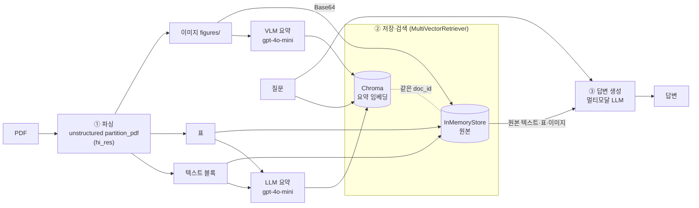

# Multimodal RAG

PDF 속 **텍스트·표·이미지(그래프)** 를 모두 검색 대상으로 삼는 멀티모달 RAG 실습 저장소입니다.

## 문제 정의

일반 RAG는 텍스트 청크만 검색하기 때문에, 수치가 **그래프나 표에만** 있는 문서에서는 "자료에 없다"고 답합니다.
이 프로젝트는 표와 이미지도 요약해 검색 대상에 넣고, 답변을 만들 때는 **요약이 아닌 원본(표·이미지)** 을 LLM에 넘겨 그래프에만 있는 정보까지 답하게 합니다.

## 아키텍처



- **검색에는 요약, 답변에는 원본**: 이미지는 그 자체로 임베딩·검색되지 않아 텍스트 요약이 필요합니다. 하지만 요약에는 정확한 수치가 빠지므로, 답변 생성에는 같은 `doc_id`로 연결된 원본을 씁니다.

## 기술 선택

| 항목 | 선택 | 이유 |
| --- | --- | --- |
| 파싱 | `unstructured` `strategy="hi_res"` | 레이아웃 모델을 써야 표·이미지가 분리 추출됨 |
| 청크 | 2,000 토큰 / 겹침 200 | 블록 경계에서 문장이 잘려 뜻이 사라지는 것을 막음 |
| 요약·답변 모델 | `gpt-4o-mini` | 비전 지원, `gpt-4-vision-preview`는 지원 종료 |
| 임베딩 | `text-embedding-3-small` | 비용 대비 성능 |
| 요약 프롬프트 | 한국어 | 한국어 질문으로 검색하므로 요약도 한국어로 맞춤 |

## 폴더 구조

```
multimodal-rag/
├── .env.example            # 필요한 환경변수 안내 (실제 키는 .env, Git 제외)
├── requirements.txt        # 의존성 목록
├── requirements.lock.txt   # 동작 확인한 버전 고정
├── data/                   # 원본 PDF·추출 결과 (Git 제외)
├── notebooks/
│   ├── Multi_modal_RAG.ipynb             # 설치 검증 + 데이터 추출
│   ├── 01_데이터추출_*.ipynb             # ① 파싱 연습
│   ├── 02_요약생성_학습.ipynb            # 텍스트·표·이미지 요약
│   └── 03_임베딩_최종체인_연습.ipynb     # 검색기·최종 체인·Before/After
└── src/
    ├── extract.py          # PDF 파싱·분류·청크 분할
    ├── summarize.py        # 텍스트·표·이미지 요약
    └── retriever.py        # 다중 벡터 검색기·최종 체인
```

## 실행 방법

사전 설치 (파이썬 패키지가 아닌 OS 프로그램):

```bash
brew install poppler tesseract    # 윈도우: 설치 후 Path 등록
pdftoppm -h && tesseract -v       # 둘 다 출력되면 성공
```

```bash
git clone https://github.com/Navi-Up/multimodal-rag.git
cd multimodal-rag

# 가상환경 생성 및 활성화 (Python 3.11 / 3.12)
python -m venv .venv
source .venv/bin/activate          # 윈도우: .venv\Scripts\activate

# 의존성 설치
pip install --upgrade pip
pip install -r requirements.txt     # 또는 requirements.lock.txt

# 커널 등록
python -m ipykernel install --user --name multimodal-rag

# .env 작성
cp .env.example .env                # 윈도우: copy .env.example .env
# .env 파일을 열어 실제 API 키를 입력
```

PDF를 `data/`에 넣고 노트북을 `Multi_modal_RAG` → `02` → `03` 순서로 실행합니다.

## Before / After

질문: **24년말 대비 26년 1분기의 누적 평가이익을 알려줘** (그래프에만 있는 수치)

| | 답변 |
| --- | --- |
| **Before** 텍스트 전용 RAG | 자료에 따르면, 2026년 1분기 누적 평가이익에 대한 구체적인 수치는 제공되지 않았습니다. … 누적 평가이익에 대한 직접적인 수치는 없습니다. |
| **After** 멀티모달 RAG | 24년말 대비 26년 1분기의 누적 평가이익은 약 571조 원입니다. |

텍스트 전용 RAG는 텍스트 청크만 검색해 수치를 찾지 못했고, 멀티모달 RAG는 그래프 이미지 2건을 검색해 원본 이미지를 근거로 답했습니다. (`notebooks/03_임베딩_최종체인_연습.ipynb` 8번 셀)

## 한계

- **한국어 OCR**: 언어를 지정하지 않으면 Tesseract가 영어로 읽어 한국어 본문이 깨집니다(예: `A SCH 2 HOLE!`). `brew install tesseract-lang` 후 `extract_pdf_elements(..., languages=["kor", "eng"])`로 해결할 수 있습니다.
- **그래프 수치는 근삿값**: VLM이 그래프를 눈으로 읽어 답하므로 정확한 값이 아닐 수 있습니다.
- **원본 저장소가 메모리**: `InMemoryStore`는 커널을 끄면 사라집니다. 서비스로 쓰려면 Redis·PostgreSQL 같은 영구 저장소와 서버형 벡터 DB가 필요합니다.
- **이미지 필터링 없음**: 로고·장식 이미지까지 모두 요약해 비용과 검색 잡음이 늘어납니다.

## 보안

- `.env`(API 키), 원본 PDF, 추출 이미지(`figures/`), 중간 결과(`*.pkl`), 벡터 DB, 도구 로그(`.bkit/`)는 `.gitignore`로 제외합니다.
- 필요한 환경변수는 `.env.example`에 키 없이 안내합니다.
